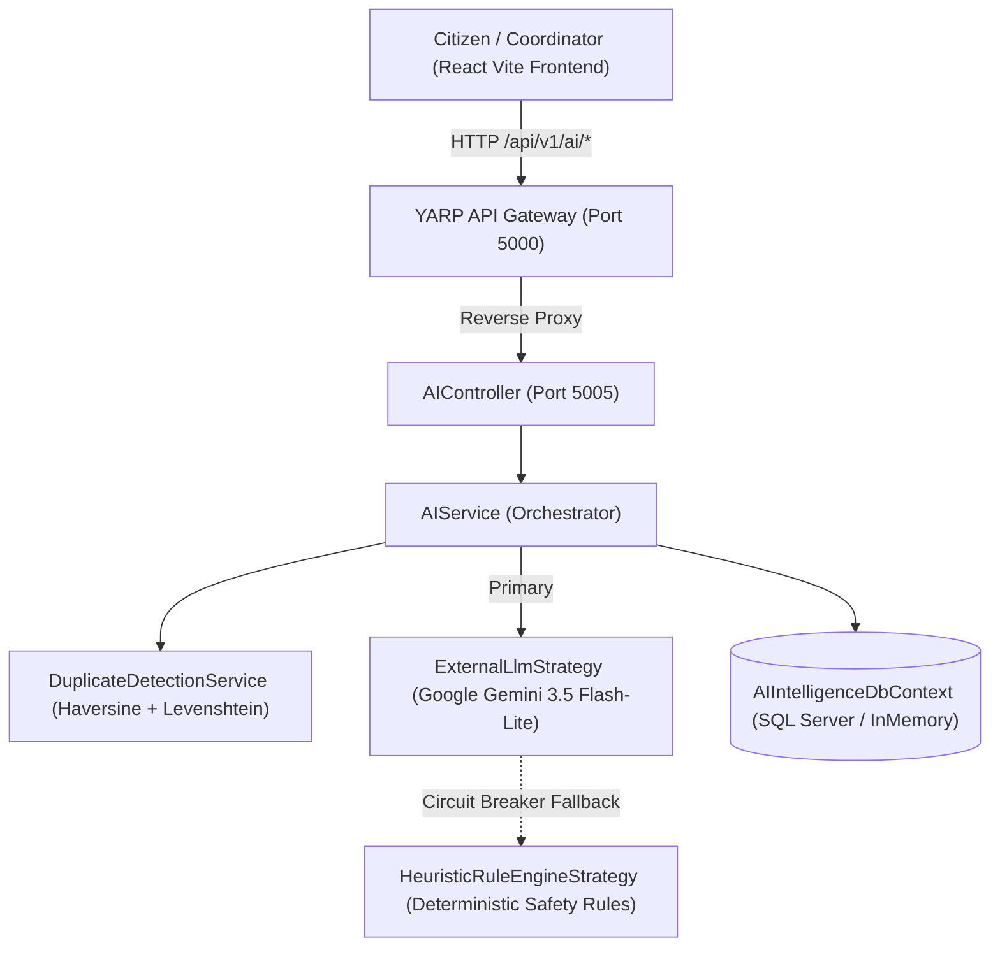

# SAHAYA Platform — Member 5 Engineering Specification
## Explainable AI Decision Support, Duplicate Detection & Governance Microservice

**Student / Contributor:** Member 5  
**Service:** `Sahaya.AIIntelligence.API`  
**Framework:** .NET 9.0 Clean Architecture / C# 13  
**Port:** `5005` (Gateway Reverse Proxy: `/api/v1/ai/*` via Port `5000`)  
**Database:** SQL Server / EF Core In-Memory Fallback  
**External Provider:** Google Gemini API (`gemini-3.5-flash-lite` / `gemini-flash-lite-latest`)

---

## 1. Executive Summary & Architectural Scope

In humanitarian disaster operations (floods, landslides, severe weather in Sri Lanka), emergency coordination centers face severe information bottlenecks. Duplicate assistance requests arrive rapidly from neighboring victims, and field coordinators require rapid triage recommendations without losing accountability.

Member 5 delivers the **AI Intelligence and Governance Microservice** for the SAHAYA Humanitarian Aid Coordination Platform, satisfying the SE205.3 Coursework 2026 specification:

1. **Automated Crisis Request Triage:** Prioritizes incoming citizen aid requests (`Critical`, `High`, `Medium`, `Low`) based on affected headcount, vulnerable members (infants, elderly, pregnant mothers), and hazard proximity.
2. **Spatial & Lexical Duplicate Detection:** Identifies duplicate emergency requests within a 200-meter radius using the **Haversine formula** and **Levenshtein string distance**, preventing aid hoarding and duplicate logistical dispatches.
3. **Conversational Crisis AI Chatbot:** Real-time dual-language (Sinhala & English) emergency guidance powered by Google Gemini 3.5 Flash-Lite LLM with a 1.2-second response latency.
4. **Resilient Dual-Strategy Engine:** Implements the Strategy Pattern. If cloud connectivity or API rate limits fail, a deterministic local rule-based safety engine handles triage and chatbot queries without downtime.
5. **Human-in-the-Loop Governance (Non-Repudiation):** Every automated decision requires coordinator validation. Any override is recorded in an immutable audit ledger (`HumanOverrideAudits`) for complete legal non-repudiation.

---

## 2. Microservice Architecture & Data Flow

---

## 3. Algorithmic Formulations

### 3.1 Spatial Duplicate Detection (Haversine Formula)

To detect whether two requests are located within the identical geographical hazard zone ($R = 6371\text{ km}$):

$$\Delta\phi = \phi_2 - \phi_1, \quad \Delta\lambda = \lambda_2 - \lambda_1$$

$$a = \sin^2\left(\frac{\Delta\phi}{2}\right) + \cos(\phi_1)\cos(\phi_2)\sin^2\left(\frac{\Delta\lambda}{2}\right)$$

$$c = 2 \cdot \operatorname{atan2}\left(\sqrt{a}, \sqrt{1-a}\right), \quad d = R \cdot c$$

A duplicate candidate is flagged if $d \le 0.20\text{ km}$ ($200\text{ meters}$).

### 3.2 Lexical Similarity (Levenshtein Distance Metric)

For two assistance request descriptions $s_1$ and $s_2$ of lengths $m$ and $n$:

$$\operatorname{lev}(i, j) = \begin{cases} 
\max(i, j) & \text{if } \min(i, j) = 0, \\
\min \begin{cases}
\operatorname{lev}(i-1, j) + 1 \\
\operatorname{lev}(i, j-1) + 1 \\
\operatorname{lev}(i-1, j-1) + 1_{(s_1[i] \ne s_2[j])}
\end{cases} & \text{otherwise.}
\end{cases}$$

$$\operatorname{Similarity}(s_1, s_2) = 1 - \frac{\operatorname{lev}(s_1, s_2)}{\max(|s_1|, |s_2|)}$$

If $\operatorname{Similarity} \ge 0.65$ within a 200m spatial cluster, requests are linked as duplicates with confidence scoring.

---

## 4. API Endpoints Reference

All endpoints are registered under `/api/v1/ai/` on Port 5005 and exposed via Swagger UI at `http://localhost:5005/swagger`.

| Method | Endpoint | Description |
|---|---|---|
| `POST` | `/api/v1/ai/triage` | Generates triage priority, confidence score, and decision rationale |
| `POST` | `/api/v1/ai/duplicates/detect` | Runs Haversine & Levenshtein duplicate cluster detection |
| `POST` | `/api/v1/ai/override` | Logs human coordinator override with non-repudiation justification |
| `POST` | `/api/v1/ai/chat` | Conversational crisis assistant (Sinhala & English) via Gemini 3.5 |
| `GET` | `/api/v1/ai/recommendations` | Retrieves all historical automated triage recommendations |
| `GET` | `/api/v1/ai/recommendations/{requestId}` | Retrieves specific recommendation by assistance request GUID |
| `GET` | `/api/v1/ai/audits` | Retrieves human override audit trail for compliance auditing |

---

## 5. Security & Governance Compliance

- **Non-Repudiation (STRIDE Mitigation):** Every coordinator override persists `OverriddenByUserId`, `OverriddenByUserName`, `OriginalRecommendation`, `NewDecision`, `JustificationReason`, and UTC timestamp.
- **Fail-Safe Defaults:** If Gemini cloud LLM encounters network partition, latency > 30s, or quota limits, the system safely falls back to local disaster safety rules.
- **CORS & Zero Trust:** Configured for local dev origins (`5173`, `5174`, `3000`) with credentialed transport.
