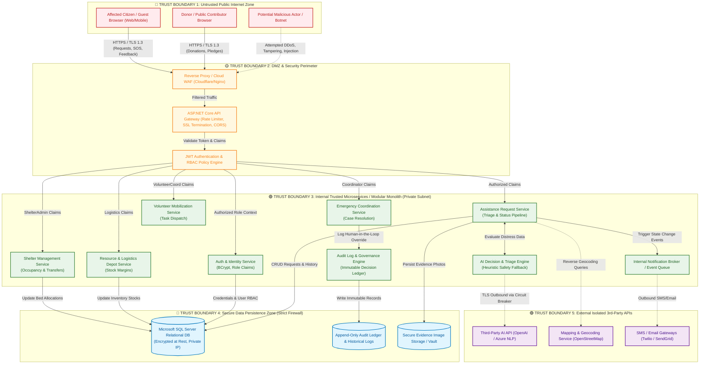
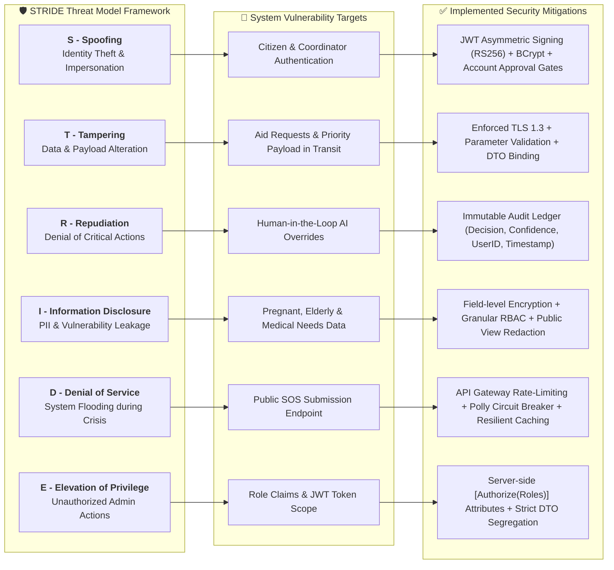

# AI-Powered Humanitarian Crisis Management and Aid Coordination Platform (SAHAYA)
> **Module:** SE205.3 Software Architecture — Coursework 2026  
> **Institution:** NSBM Green University Town  
> **Coursework Type:** Group Assignment (Weight: 40%)  
> **Technology Baseline:** C# ASP.NET Web API + SQL Server + Modern Web Client (React 19, TypeScript, Tailwind CSS v4)  
> **Submission Deadline:** 30th November 2026  

---

## 1. Executive Summary & Scenario

The **SAHAYA** platform is an enterprise-grade, multi-organisation crisis coordination system engineered for national and international humanitarian emergencies (floods, landslides, severe cyclonic storms, tsunamis, disease outbreaks, and mass displacement).

The platform bridges affected citizens, government operational commanders, humanitarian NGOs (e.g., Red Cross, UN agencies), field volunteers, shelters, and donors into a unified, secure, real-time command structure.

### Key Scope Boundary
* **Software-Centric:** The system focuses on software architecture, RESTful microservices, real-time dispatch, human-in-the-loop AI governance, and secure data storage.
* **No Hardware/IoT Dependencies:** Telemetry, location pinning, camp capacity, and incident tracking operate through browser GPS APIs, authorized user reports, and digital mapping integrations without requiring physical IoT sensors or smart-city infrastructure.

---

## 2. Principal System Actors (RBAC Hierarchy)

| # | Actor | Primary Responsibilities & Operational Scope | Target Dashboard / Route |
|:---|:---|:---|:---|
| **1** | **Affected Person / Citizen** | Submits emergency SOS aid requests, manages vulnerable household profiles, tracks aid delivery timeline, accesses safety guides and shelter locations. | `/citizen/dashboard` |
| **2** | **Emergency Coordinator** | High-level operational command, triage oversight, reviews AI recommendations, resolves conflicting aid priorities, escalates relief missions. | `/coordinator/dashboard` |
| **3** | **Incident / Case Manager** | Manages incident lifecycles, validates incoming cases, verifies ground distress reports, updates case progress. | `/coordinator/incidents` |
| **4** | **Resource & Logistics Manager** | Manages warehouse supply inventories, relief kit dispatch, tracking low-stock thresholds, and inter-agency supply requisitions. | `/resources` |
| **5** | **Shelter Administrator** | Safe haven registrations, live occupancy audits, facility tracking, bed allocation, and inter-camp surplus resource transfers. | `/shelters` |
| **6** | **Volunteer Coordinator** | Volunteer skill profiling, mobilization rosters, task creation, and tracking mission completion. | `/volunteers` |
| **7** | **Field Volunteer** | Mobile mission dispatch, checklist task execution, disaster zone location check-ins. | `/volunteer/dashboard` |
| **8** | **Donor / Funding Officer** | Tracks crowdfunding campaigns, records monetary & in-kind pledges, views fund disbursement and transparency impact reports. | `/donor/dashboard` |
| **9** | **Partner Organisation Officer** | Joint relief agency coordination (Red Cross, SLRCS), inter-agency resource allocation, and collaborative GIS mapping. | `/partner/dashboard` |
| **10**| **System Administrator** | National command oversight, system telemetry & service health, RBAC privilege assignment, account approvals/suspensions, and immutable audit logs. | `/dashboard`, `/admin/dashboard` |

---

## 3. Core Platform Modules & Requirements

### A. Affected Person / Citizen Portal
- **User Authentication:** Registration, JWT login, and public guest SOS request submission without requiring pre-registration.
- **Household Vulnerability Profiling:** Captures household composition, vulnerable family members (pregnant women, infants, elderly, persons with disabilities, critical medication requirements).
- **Emergency SOS Aid Request Wizard:** Multi-step wizard (Aid Category, Urgency, GPS coordinate pinning via interactive map, address resolution, photographic evidence upload).
- **Status Tracking & Real-Time Timeline:** Submitted ➔ Under Review ➔ Dispatched ➔ Delivered with time-stamped milestone notes.
- **Public Disaster Guides & Shelters:** Flood, landslide, cyclone checklists with hotline access (117 / 1990).
- **Post-Delivery Feedback:** Rate aid delivery quality, volunteer conduct, and condition of relief supplies.

### B. Emergency Coordination Dashboard
- **Incident Registry & Categorisation:** Monitor disaster events with severity ratings (Critical, High, Medium, Low).
- **Real-Time Dispatch Pipeline:** Monitor open, overdue, escalated, and resolved requests.
- **District-Wise Aggregations:** Sri Lanka 25-district geospatial and administrative filtering.
- **Operational Timeline:** Complete historical log of coordinator decisions, status transitions, and notes.

### C. AI Decision-Support Services
- **Automated Triage & Urgency Scoring:** Evaluates distress descriptions, vulnerable household members, and conditions to calculate urgency scores.
- **Confidence Rating & Explainability Rationale:** Outputs confidence percentage (e.g. 87%) and natural language rationale explaining the assessment.
- **Duplicate Request Detection:** Identifies near-duplicate distress calls based on GPS proximity and semantic description similarity without deleting genuine requests.
- **Resource & Shelter Matching:** Recommends nearest depots and shelters with capacity and suitable facilities (e.g., wheelchair access, medical tent).
- **Bilingual Crisis Assistant:** Conversational AI assistant supporting English and Sinhala with rule-based fallback.

### D. Human-in-the-Loop Governance
- **Mandatory Decision Override:** Authorised Coordinators can Accept, Modify/Override (adjust category, priority), or Reject AI assessments.
- **Immutable Audit Trail:** Records original AI recommendation, confidence value, human action, justification note, coordinator ID, and UTC timestamp.
- **No Autonomous High-Stakes Action:** AI assists but never independently dispatches or cancels life-saving assistance without human authorization.

### E. Resource and Logistics Management
- **Warehouse Inventory Depot:** Tracks available, allocated, dispatched, and reserved quantities of emergency supplies (water, ration boxes, medical kits, tents, boats).
- **Low-Stock Safety Margins:** Configurable thresholds triggering warning banners.
- **Allocation & Dispatch Logging:** Direct linking of warehouse assets to specific emergency requests.
- **Inter-Agency Requisitions:** Submits and fulfills resource requests across partner NGOs.

### F. Shelter & Evacuation Camp Management
- **Safe Haven Registry:** Real-time capacity, current occupancy, remaining beds, and occupancy percentage bars.
- **Camp Facilities & Accessibility:** Clean drinking water, community kitchens, medical officers, child-friendly spaces, wheelchair accessibility.
- **Camp Supply Requisitions & Burn-Rate Tracker:** Calculates daily consumption of water and ration packs to predict depletion days.
- **Inter-Camp Stock Transfer:** Reallocates surplus supplies from high-satiety camps to depleted shelters.

### G. Volunteer Management
- **Roster & Skill Matrix:** Categorises volunteers by rescue skills (medical, water rescue, food distribution, counseling).
- **Task Assignment:** Links volunteer assignments directly to active assistance requests with priority and deadlines.
- **Field GPS Check-In:** Tracks volunteer deployment locations and on-duty statuses.

### H. Donor & Donation Management
- **Crowdfunding Campaigns:** Public donation drives with financial target progress indicators.
- **Monetary & In-Kind Pledges:** Record bank transfer references or physical goods deliveries.
- **Transparency Impact Reports:** Transparent tracking of mobilized funds vs. disbursed relief supplies.

### I. Mapping and Location Services
- **Interactive Leaflet GIS Map:** Displays hazard zones, open evacuation shelters, and rescue requests.
- **Custom Visual SVG Pins:** Distinct color-coded pins (Red: Hazard, Teal: Shelter, Amber: Request, Blue: Selected Location).
- **Coordinate Precision:** Browser GPS location lock with accuracy radius and reverse-geocoding fallback.

---

## 4. Architectural Design & Technical Baseline

### 4.1 Backend Architecture (C# ASP.NET Web API)
- **Framework:** .NET 8 / 9 ASP.NET Web API
- **Architectural Style:** Modular Monolith / Microservices Architecture
- **Design Patterns Utilised:**
  - **Repository & Unit of Work Pattern:** Decouples data access logic from business rules.
  - **Dependency Injection (DI):** Inversion of control across all controllers, services, and repositories.
  - **Strategy Pattern:** Dynamic selection of triage scoring algorithms (Heuristic Rule-Engine Strategy vs. ML NLP Classifier Strategy).
  - **Factory Pattern:** Creation of specialized assistance notifications (SMS, Email, Broadcast Alert).
  - **Observer / Pub-Sub Pattern:** Event-driven notification dispatch when assistance request state transitions occur.
- **Database:** Microsoft SQL Server with Entity Framework Core (EF Core) code-first migrations.
- **Security:** JWT (JSON Web Tokens) with asymmetric signing, bcrypt password hashing, role-based `[Authorize(Roles = "...")]` attributes, CORS policy, rate-limiting middleware.
- **Resilience:** Polly circuit breaker & retry policies for external AI, mapping, and communication APIs.

### 4.2 Frontend Architecture (Modern Client)
- **Framework:** React 19 + TypeScript + Vite 6
- **Styling:** Tailwind CSS v4 with custom dynamic CSS variable tokens (`--theme-primary`, `--theme-glow`).
- **Theme Engine:** `ThemeContext` supporting 4 color palettes (Ocean Blue, Emerald Green, Royal Purple, Warm Amber), 3 display modes (Light, Dark, System Sync), and circular wipe transition animation.
- **Bilingual Support:** `LanguageContext` supporting English & සිංහල.
- **Hybrid Data Client:** `api.ts` connects to live REST endpoints with seamless in-memory and `localStorage` mock fallback for resilient offline demonstration.

---

## 5. Trust Boundary Diagram

---

## 6. STRIDE Threat Model Analysis & Diagram

The STRIDE model assesses security threats across all humanitarian software components to guarantee high availability, confidentiality of vulnerable citizens, and non-repudiation of life-saving decisions.

### 6.1 STRIDE Threat Diagram

### 6.2 Detailed STRIDE Threat Mitigation Matrix

| STRIDE Category | Threat Description in Humanitarian Context | Target Asset | Severity | Technical Countermeasures & Mitigations Implemented |
|:---|:---|:---|:---:|:---|
| **Spoofing (S)** | An attacker impersonates an Emergency Coordinator to close cases, or a botnet floods fake citizen identities. | Login Endpoint, JWT Tokens | **Critical** | • JWT bearer tokens with expiration and signature verification. • BCrypt (Work Factor 12) password hashing. • Official staff registration gated behind Administrator approval (`/pending-approval`). |
| **Tampering (T)** | Malicious actor intercepts and modifies an aid request payload in transit to alter coordinates or siphon relief goods. | REST APIs, HTTP Payloads | **High** | • End-to-end TLS 1.3 encryption. • Strict DTO schema validation using FluentValidation / DataAnnotations. • Foreign key database constraints preventing detached allocation tampering. |
| **Repudiation (R)** | A Coordinator denies having overridden an AI safety triage recommendation or rejecting an urgent request. | AI Triage Overrides, Case Dispatches | **High** | • **Non-Repudiation Human-in-the-Loop Audit Trail**. • System automatically captures: `OriginalAiRecommendation`, `ConfidenceScore`, `HumanAction`, `JustificationReason`, `UserId`, and `UtcTimestamp` in an append-only database table. |
| **Information Disclosure (I)** | Vulnerable citizens' locations, phone numbers, or sensitive health data (e.g. pregnancy, disabilities) exposed publicly. | Citizen Household Profiles, GIS Map | **Critical** | • Public endpoints redact citizen names and specific phone numbers. • Strict RBAC policies ensuring only verified Coordinators can view vulnerable household rosters. • Sensitive attributes excluded from browser localStorage. |
| **Denial of Service (D)** | High traffic surge during a catastrophic flood breaches server capacity; external AI API becomes unreachable. | API Gateway, AI Decision Service | **High** | • Token-bucket Rate Limiting at the API Gateway. • **Polly Resilience Policies:** Circuit breaker and timeout handlers. • **Rule-Based Heuristic Safety Engine:** Automatic fallback to heuristic scoring when external NLP AI models timeout. |
| **Elevation of Privilege (E)** | A registered Citizen or Field Volunteer modifies user role in request payload to grant themselves Administrator privileges. | User Roles, RBAC Token Claims | **Critical** | • Server-side authorization attributes `[Authorize(Roles = "Admin")]` on all management endpoints. • Client-sent role inputs strictly ignored on user registration; roles can only be granted by System Administrators via `/admin/users`. |

---

## 7. Compliance & Coursework Deliverables Checklist

- [x] **Client Application:** Responsive modern web client built with React 19, TypeScript, and Tailwind CSS v4 supporting 10 distinct roles.
- [x] **Theme & Accessibility Engine:** 4 Color Palettes (Blue, Green, Purple, Amber) + 3 Display Modes (Light, Dark, System) with circular wipe transitions.
- [x] **Bilingual Localization:** English and Sinhala navigation, alerts, and safety guides.
- [x] **Backend Specification:** C# ASP.NET Web API with Entity Framework Core and SQL Server schema design.
- [x] **AI Decision-Support & Human Governance:** AI Triage with Confidence scoring, Explainability breakdown, and human override audit logging.
- [x] **Logistics & Inventory:** Depot stock tracking with low-stock warnings, kit dispatch logs, and shelter burn-rate analytics.
- [x] **GIS Command Map:** Interactive Leaflet GIS mapping with custom colored SVG pins and coordinate location picking.
- [x] **Security & Threat Model:** Complete Trust Boundary Architecture and STRIDE Threat Matrix documented.
